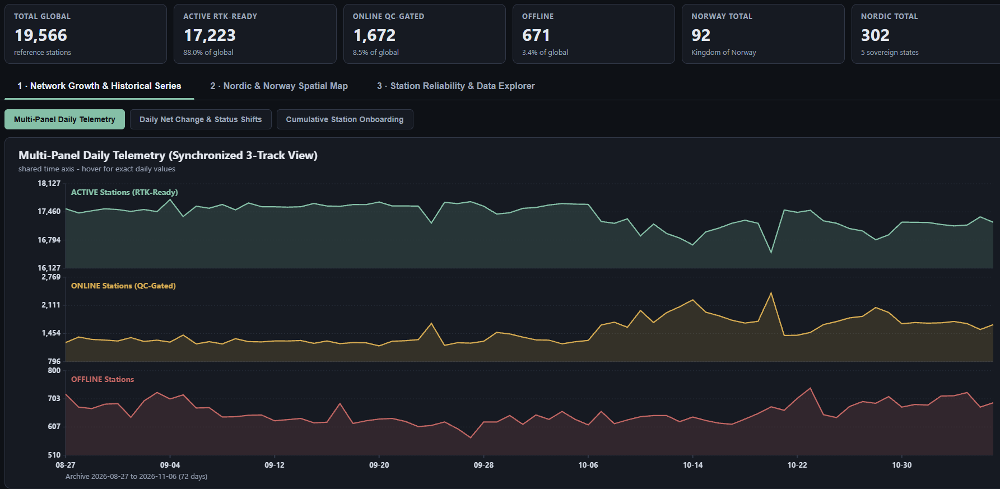
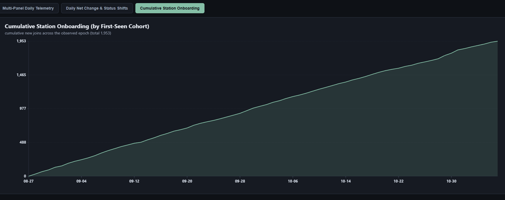
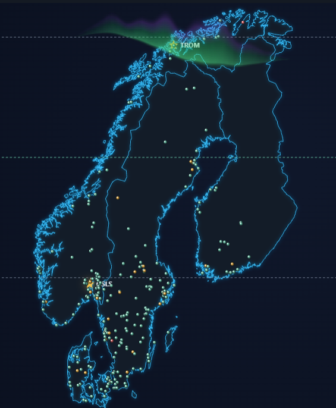

# High-Latitude GNSS Infrastructure & Quality Control Telemetry (GEODNET / IGS)

An independent GNSS data-science project at the **University of Oslo** (Mathematics: Data,
Modelling and Computations). It classifies GEODNET reference stations across the Nordic region and
visualises their quality-control behaviour at high latitudes. Everything runs on the **Python
standard library** — no external packages are required.

**Screenshots** *(click any image to view full resolution)*

<table>
  <tr>
    <td align="center" width="33%">
      <a href="assets/01_multi_panel_telemetry.png"></a>
      <br/><sub>Tab 1 — Multi-Panel Daily Telemetry (3-track ACTIVE / ONLINE / OFFLINE).</sub>
    </td>
    <td align="center" width="33%">
      <a href="assets/02_cumulative_onboarding.png"></a>
      <br/><sub>Tab 1 — Cumulative Station Onboarding (1,953 new stations).</sub>
    </td>
    <td align="center" width="33%">
      <a href="assets/03_geodetic_map_3d.png"></a>
      <br/><sub>Tab 2 — Interactive 3D-styled geodetic map with RTK rings and IGS baselines.</sub>
    </td>
  </tr>
</table>

---

## What Is Included Right Now

Two working programs and three research datasets.

**Programs**

1. `src/nordic_station_classifier.py` — topology and network classification. It tests every station
   against the Natural Earth 1:10m national boundaries (point-in-multipolygon, with a 20 km coastal
   closure for fjords), splits Norway into five research zones, separates hardware classes, and
   writes the CSV datasets, the report and this README.
2. `src/telemetry_ui.py` — a local dashboard server. It serves the interactive three-tab dashboard
   and a JSON endpoint `/api/telemetry` built from the local files only.

**Datasets**

- `data/nordic_geodnet_stations.csv` — all Nordic stations (302).
- `data/norway_only_stations.csv` — Norwegian stations only (92), sorted by distance to `OSLS`.
- `data/nordic_boundaries_10m.geojson` — Natural Earth 1:10m polygons for the five Nordic states.

**What each chart shows**

*Tab 1 — Network Growth & Historical Series*
- *Multi-Panel Daily Telemetry (3-Track View):* synchronized daily series of `ACTIVE` (RTK-ready),
  `ONLINE` (held by the QC gate: epoch completeness < 90 %, multipath MP12 > 0.7 m, or SNR < 32
  dB-Hz) and `OFFLINE` stations, each on its own Y axis. This makes it easy to spot days of
  network-wide quality degradation, when stations move from `ACTIVE` to `ONLINE`.
- *Daily Net Change & Status Shifts:* net day-over-day change in the number of active stations.
- *Cumulative Station Onboarding:* cumulative curve of new stations (1,953 new stations over the
  72-day archive window).

*Tab 2 — Nordic & Norway Spatial Map*
- *Interactive 3D-Styled Geodetic Map (Natural Earth 1:10m):* interactive map of Scandinavia,
  Norway and Svalbard with the auroral-oval band (`65°N Auroral Oval`), RTK coverage rings
  (`15 km / 30 km`), Haversine baseline vectors to three official IGS/EUREF observatories (`OSLS`
  in Oslo, `TROM` in Tromsø, `NYA2` on Svalbard), and region filtering that keeps the current zoom.
- *Sovereign States & Norwegian Latitudinal Zones:* the 302 stations across the five Nordic
  countries (`SWE`, `NOR`, `DNK`, `FIN`, `ISL`) and the 92 Norwegian stations split into five
  latitude zones and two hardware classes (`GEODNET_MINER` vs `PUBLIC_IGS_EUREF`).

*Tab 3 — Station Reliability & Data Explorer*
- *Status Flap Frequency & Latitude Band Availability:* stability analysis and status-transition
  counts (`flaps`) across latitude bands from `54°N` to `81°N`, plus an interactive table with
  search and sorting for every station.

---

## Live Network Dataset (Snapshot: 2026-11-06 14:09:31 UTC)

Global stations observed: **19566** — Nordic stations: **302** — Norway:
**92**.

### Nordic stations by sovereign state

| ISO | Country | Stations | Share |
| :--- | :--- | ---: | ---: |
| NOR | Norway | 92 | 30.5% |
| SWE | Sweden | 145 | 48.0% |
| FIN | Finland | 23 | 7.6% |
| DNK | Denmark | 34 | 11.3% |
| ISL | Iceland | 8 | 2.6% |

### Kingdom of Norway — research zones

| Zone | Stations |
| :--- | ---: |
| NO-Central-Trondelag | 10 |
| NO-North-Auroral | 15 |
| NO-South-Oslo-Ostlandet | 45 |
| NO-South-West-Vestlandet | 20 |
| NO-Svalbard-Arctic | 2 |

### Hardware class (Nordic region)

| Class | Stations |
| :--- | ---: |
| `GEODNET_MINER` | 293 |
| `PUBLIC_IGS_EUREF` | 9 |

---

## Upcoming Research Phases

- **Phase 2 — Dual-frequency signal engine.** A parser for RINEX 3.04 and RTCM 3.2 observations
  (L1/L2/E5a) that computes Slant TEC (STEC) from the geometry-free combination and the ROTI index
  (Welford online standard deviation, ionospheric pierce point at 350 km).
- **Phase 3 — Error separation.** Statistical separation of regional space weather (auroral
  scintillation) from local antenna-installation errors (multipath MP12, QC error code 310).

---

## How to Run (Windows, macOS, Linux)

Requirements: **Python 3.11+**. No third-party libraries — the standard library is enough.

### Windows (PowerShell or CMD)

```bat
git clone https://github.com/EkebergByte/UIO_GNSS_LAB.git
cd UIO_GNSS_LAB
python src\nordic_station_classifier.py
python src\nordic_station_classifier.py --refresh
python src\telemetry_ui.py
```

### macOS / Linux (Bash or Zsh)

```bash
git clone https://github.com/EkebergByte/UIO_GNSS_LAB.git
cd UIO_GNSS_LAB
python3 src/nordic_station_classifier.py
python3 src/nordic_station_classifier.py --refresh
python3 src/telemetry_ui.py
```

`python src/nordic_station_classifier.py` recomputes the classification from the local cache (no
network). Add `--refresh` to fetch a fresh network snapshot first. `python src/telemetry_ui.py`
starts the local dashboard and opens it in your browser on a free port between 8085 and 8095.

---

## Repository Structure

```
UIO_GNSS_LAB/
├── README.md
├── LICENSE
├── .gitignore
├── check_purity.py
├── src/
│   ├── nordic_station_classifier.py   classification + dataset/report/README generator
│   ├── gnss_common.py                 shared constants, geometry helpers and observatories
│   ├── telemetry_ui.py                local dashboard server (/api/telemetry)
│   └── dashboard.html                 three-tab interactive dashboard
├── data/
│   ├── nordic_boundaries_10m.geojson
│   ├── nordic_geodnet_stations.csv
│   └── norway_only_stations.csv
├── docs/
│   ├── report_template.md
│   ├── NORDIC_NETWORK_REPORT.md
│   └── readme_template.md
└── assets/
    ├── 01_multi_panel_telemetry.png
    ├── 02_cumulative_onboarding.png
    └── 03_geodetic_map_3d.png
```

---

## Acknowledgement

Thanks to the **GEODNET Foundation** and its station operators for the open reference network; the
**IGS** and **EUREF** permanent networks for the reference stations used as benchmarks; and
**Kartverket** for the Norwegian geodetic reference framework. Boundary data come from **Natural
Earth** (public domain).

---

## License

Released under the **MIT License** — see [`LICENSE`](LICENSE).
Copyright (c) 2026 University of Oslo GNSS Data Science Research Project.
